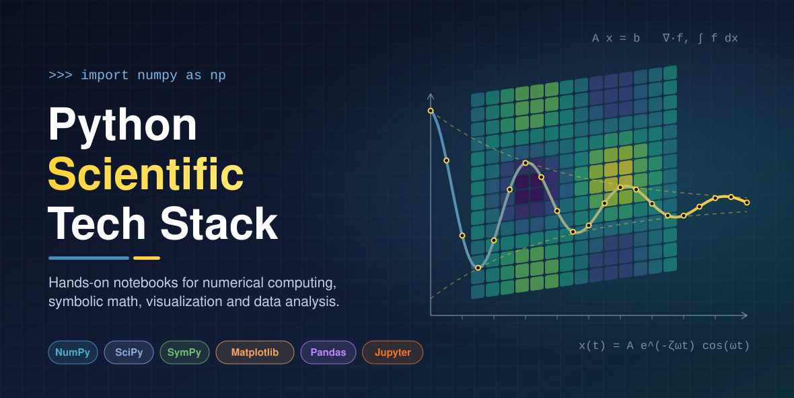
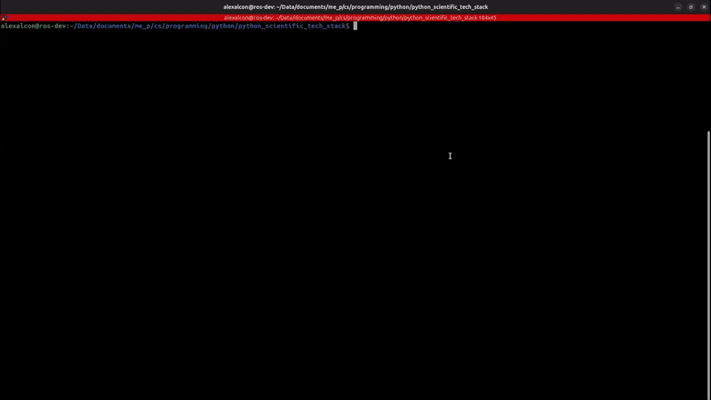
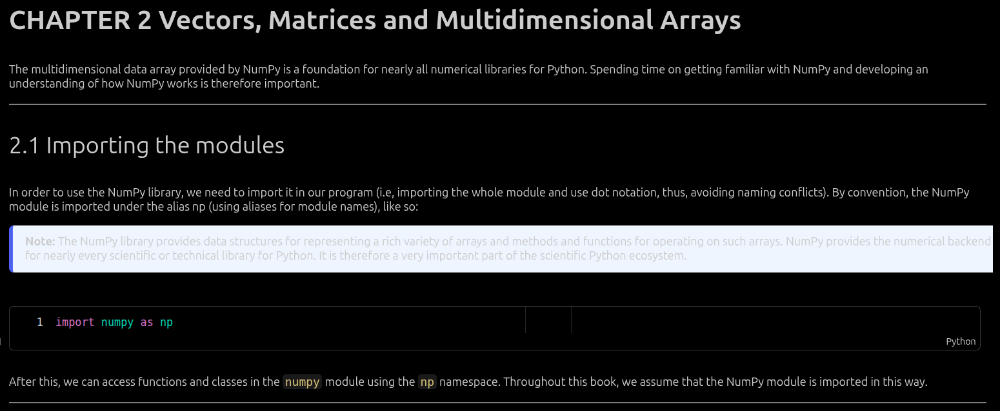
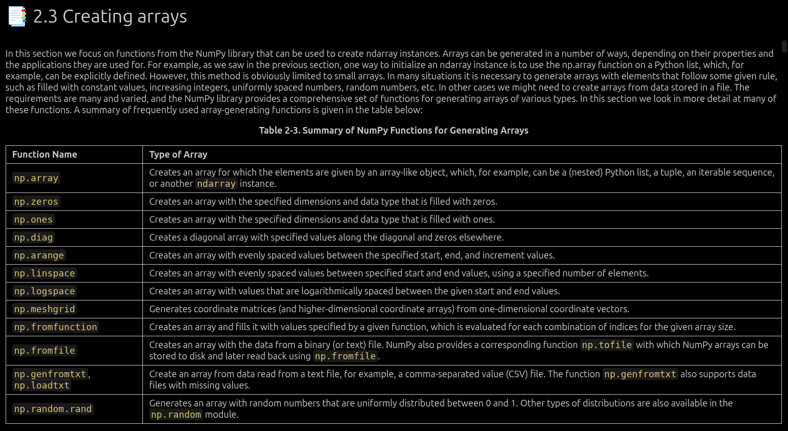

<!-- ────────────────────────────── -->
<!-- header: project logo or banner -->
<!-- ────────────────────────────── -->
<p align="center">
  <a href="https://github.com/alexalcon/python_scientific_tech_stack">
    <!-- please provide path to your logo here -->
    
    <!--  -->
  </a>
</p>

<!-- ───────────────────────────────────────────────────────────────── -->
<!-- header: project title, one line description, links and dev badges -->
<!-- ───────────────────────────────────────────────────────────────── -->
<h1 align="center">Python Scientific Tech Stack</h1>

<div align="center">
  <p>
    Hands-on notebooks and code for mastering Python's scientific computing tech stack: IPython, JupyterLab, NumPy, SciPy, SymPy, Matplotlib, Pandas and beyond.
    <br>
    <br>
    <!-- project informational links and badges -->
    <a href="./CHANGELOG.md">Changelog</a>
    ·
    <a href="https://github.com/alexalcon/python_scientific_tech_stack/issues/new?assignees=&labels=bug&template=01_BUG_REPORT.md&title=bug%3A+">Report a Bug</a>
    ·
    <a href="https://github.com/alexalcon/python_scientific_tech_stack/issues/new?assignees=&labels=enhancement&template=02_FEATURE_REQUEST.md&title=feat%3A+">Request a Feature</a>
    ·
    <a href="https://github.com/alexalcon/python_scientific_tech_stack/issues/new?assignees=&labels=question&template=04_SUPPORT_QUESTION.md&title=support%3A+">Ask a Question</a>
  </p>

  [](LICENSE)
  [](https://github.com/alexalcon/python_scientific_tech_stack/issues?q=is%3Aissue+is%3Aopen+label%3A%22help+wanted%22)
</div>

<br>

<!-- ────────────────────── -->
<!-- header: feature badges -->
<!-- ────────────────────── -->
<div align="center">

  [](https://www.python.org/)
  [](https://jupyter.org/)

  [](https://numpy.org/)&nbsp;
  [](https://scipy.org/)&nbsp;
  [](https://www.sympy.org/)&nbsp;
  [](https://matplotlib.org/)&nbsp;
  [](https://pandas.pydata.org/)

</div>

<!-- ──────────────────────────────────────── -->
<!-- header: detailed synopses of the project -->
<!-- ──────────────────────────────────────── -->
<div align="center">
  <p align="center">
  Python has become the common language of scientific and engineering computing, thanks to a mature ecosystem of open-source libraries built around fast, vectorized array operations. This repository is a structured, hands-on journey through that ecosystem.
  </p>
  <p align="center">
  It collects chapter-by-chapter Jupyter notebooks and scripts that reproduce, extend and annotate the examples from reference books (and other resources) such as <em>Numerical Python</em> by Robert Johansson, covering arrays and linear algebra, symbolic computation, plotting, equation solving, optimization, interpolation, integration, differential equations and data analysis. Also provides practical examples to reinforce learning.
  </p>
  <p align="center">
  Reading about numerical methods is not enough to master them. Running, modifying and documenting every example turns theory into working intuition, and leaves behind a reusable, well-organized reference for future projects in robotics, control and data-driven engineering, or simple, to just review and reinforce the understanding of the material.
  </p>
</div>

<!-- ──────────────────────────────────────────────────────── -->
<!-- header: screenshot gift that shows how the project works -->
<!-- ──────────────────────────────────────────────────────── -->
<div align="center">
  <a href="./assets/readme/gifs/demo.gif">
    
  </a>
</div>

<!-- ───────────────────────── -->
<!-- header: table of contents -->
<!-- ───────────────────────── -->
## Table of Contents
<!-- body -->
- [About](#about)
  - [Built With](#built-with)
- [Getting Started](#getting-started)
  - [Prerequisites](#prerequisites)
  - [Installation](#installation)
  - [Usage](#usage)
- [Roadmap](#roadmap)
- [Support](#support)
- [Project assistance](#project-assistance)
<!-- footer -->
- [Contributing](#contributing)
- [Authors & contributors](#authors--contributors)
- [Security](#security)
- [License](#license)
- [Acknowledgements](#acknowledgements)

---

<!-- ─────────────────────────────────────────── -->
<!-- body and footer: table of contents sections -->
<!-- ─────────────────────────────────────────── -->

## About

Scientific computing underpins modern engineering: simulating dynamical systems, designing controllers, processing sensor signals and analyzing experimental data all reduce to numerical operations on arrays, matrices and functions. Over the last two decades, Python and its scientific stack (NumPy, SciPy, SymPy, Matplotlib and Pandas, among others) have become the de facto open-source toolkit for this work, used everywhere from university laboratories to industrial research teams. This repository presents a practical, code-first study of that toolkit, organized as a companion to well-established reference books.

Learning the scientific Python stack is often fragmented. Tutorials tend to cover isolated features, textbook examples are read but rarely executed, and the knowledge gained is scattered across temporary scripts that are difficult to revisit. Library APIs also evolve, so code printed in books can become outdated, and the reasoning behind each numerical technique is easily lost when examples are copied without commentary. As a result, there is no single, reproducible and personally annotated reference that connects the theory of numerical methods with working, up-to-date Python code.

The goal of this project is to develop a structured, reproducible collection of annotated Python code for the scientific computing stack. To achieve it, the project sets out to: implement the examples of some books chapters and standalone examples as executable Jupyter notebooks; organize the material by book and chapter in a consistent directory structure; document each example with explanatory Markdown and comments that state the underlying concept; update outdated code to current library versions; extend selected examples with additional cases relevant to robotics, control and data analysis; and track the evolution of the repository through a changelog and version control.

This work matters because a hands-on, well-documented reference shortens the path from theory to practice. It directly benefits the author as a long-term study and reference resource, and it is equally useful to students, engineers and self-learners who want concrete, runnable examples of array programming, linear algebra, symbolic mathematics, numerical integration, optimization and data visualization. The project applies and reinforces core concepts from numerical analysis, linear algebra and scientific programming, turning them into reusable tools for future engineering projects.

The project is bounded by its sources and purpose. It follows the content and order of the selected books, it targets Python 3 with the library versions available at the time each chapter is written, and its notebooks are educational rather than production-grade, optimized for clarity over performance. Progress depends on the author's available study time, so chapters are added incrementally. In terms of scope, the repository currently covers the introduction to computing with Python and NumPy arrays (vectors, matrices and multidimensional arrays) from *Numerical Python*, and it will progressively incorporate the remaining chapters on symbolic computing, plotting, equation solving, optimization, interpolation, integration, ordinary differential equations, sparse matrices, data analysis and statistics, together with additional books of the scientific Python ecosystem.

<!-- optional -->
<!-- let your imagination come up in here -->
<details>
<summary><strong>Functionality Screenshots</strong></summary>
<p>Some relevant functionality screenshots of the project:</p>

<!-- > **[?]**
> Please provide your screenshots here (store them in `./assets/readme/screenshots/`). -->

<!-- just add bold title sections instead of a table like below -->
<!-- EDIT THIS -->
**Numerical Python Book by Robert Johansson — Notebooks**
---
|                                        Chapter 2 Notebook — Main Header                                         |                                        Chapter 2 Notebook — Creating Arrays                                         |
| :---------------------------------------------------------------------------------------: | :---------------------------------------------------------------------------------------: |
|  |  |
</details>

<!-- ─────────────────────────────────────────────────────────────────────────────── -->
<!-- the following sections (Built With to Usage) are intentionally left empty.      -->
<!-- they are reserved for the maintainer's own creativity and conventions, since    -->
<!-- only the owner of the project knows best how it is built, installed and used.   -->
<!-- ─────────────────────────────────────────────────────────────────────────────── -->

### Built With

This project is written in Python and developed as Jupyter notebooks. Its stack follows [*Numerical Python*](https://link.springer.com/book/10.1007/978-1-4842-4246-9) (2nd edition, Apress) by Robert Johansson, which introduces the main libraries of the scientific Python ecosystem chapter by chapter, so the stack grows as new chapters are added. The tables below separate the technologies in use today from those planned for upcoming chapters. Versions are those installed in the project's environment at the time of writing.

**Language and interactive environment**

| Technology | Version | Role in the project |
| :--------- | :------ | :------------------ |
| [Python](https://www.python.org/) | 3.12 | Programming language of all the examples. |
| [JupyterLab](https://jupyter.org/) | 4.5 | Environment where the notebooks are written and executed. |
| [IPython](https://ipython.org/) and [ipykernel](https://github.com/ipython/ipykernel) | 9.14 / 7.3 | Interactive kernel behind the notebooks. The `IPython.display` module provides rich output in Chapter 1. |
| [ipywidgets](https://ipywidgets.readthedocs.io/) | 8.1 | Interactive controls, such as the slider that updates a plot live in Chapter 1. |
| [Jupyter QtConsole](https://qtconsole.readthedocs.io/) | 5.7 | Alternative Jupyter frontend presented in Chapter 1, installed in the environment. |

Notebook cells also combine Markdown, HTML and LaTeX for explanations, rich output and mathematical formulas.

**Libraries**

| Technology | Version | Role in the project |
| :--------- | :------ | :------------------ |
| [NumPy](https://numpy.org/) | 2.4 | Multidimensional arrays and vectorized computing, the subject of Chapter 2. |
| [Matplotlib](https://matplotlib.org/) | 3.10 | Plotting, used in the interactive example of Chapter 1 and the subject of Chapter 4. |
| [Requests](https://requests.readthedocs.io/) | 2.34 | Downloads the image data shown in the rich output examples of Chapter 1. |
| [SymPy](https://www.sympy.org/) | 1.14 | Symbolic computing, installed in the environment and ready for Chapter 3. |
| [Pillow](https://python-pillow.org/) | 12.1 | Image processing library, installed in the environment. |

**Planned for upcoming chapters**

These libraries are covered later in the book. They are not yet part of the project's environment and will be added as the corresponding chapters are written.

| Technology | Book chapters | Topic |
| :--------- | :------------ | :---- |
| [SciPy](https://scipy.org/) | 5–11, 13, 17 | Equation solving, optimization, interpolation, integration, differential equations, sparse matrices, statistics and signal processing. |
| [NetworkX](https://networkx.org/) | 10 | Graphs and networks. |
| [FEniCS](https://fenicsproject.org/) | 11 | Partial differential equations with the finite-element method. |
| [Pandas](https://pandas.pydata.org/) and [Seaborn](https://seaborn.pydata.org/) | 12 | Data processing, analysis and statistical graphics. |
| [statsmodels](https://www.statsmodels.org/) and [Patsy](https://patsy.readthedocs.io/) | 14 | Statistical modeling. |
| [scikit-learn](https://scikit-learn.org/) | 15 | Machine learning. |
| [PyMC](https://www.pymc.io/) | 16 | Bayesian statistics. |
| [h5py](https://www.h5py.org/) and [PyTables](https://www.pytables.org/) | 18 | Data input and output with HDF5. |
| [Numba](https://numba.pydata.org/) and [Cython](https://cython.org/) | 19 | Code optimization. |

**Development tools**

| Technology | Role in the project |
| :--------- | :------------------ |
| [Conda](https://docs.conda.io/) (Miniconda) and [conda-forge](https://conda-forge.org/) | Isolated environment and package management. |
| [Visual Studio Code](https://code.visualstudio.com/) | Editor, with shared workspace settings in `.vscode/`. |
| [Git](https://git-scm.com/) and [GitHub](https://github.com/) | Version control, issue tracking and project hosting. |
| [GitHub Actions](https://github.com/features/actions) | Repository automation: label syncing and verification, stale issue and pull request cleanup, and locking of closed threads. |
| [CodeQL](https://codeql.github.com/) | Automated code security scanning, run as a GitHub Actions workflow. |

## Getting Started

### Prerequisites

**[Conda](https://docs.conda.io/) is mandatory for this project**, and you should know how to use it before going further. A working installation is needed ([Miniconda](https://www.anaconda.com/docs/getting-started/miniconda/main) is enough), along with an understanding of the concepts below.

**Why Conda**

Conda is best for projects that need compiled scientific, vision, GPU or robotics stacks, and this is a scientific Python project. These stacks rely on much more than Python code: their libraries sit on top of compiled software such as BLAS and LAPACK, HDF5, MPI, FFmpeg or the CUDA runtime, usually written in C, C++ or Fortran.

`pip` installs Python packages and cannot manage that software as dependencies of their own, so each wheel has to bundle its binaries or expect them on the system. Conda treats Python and these libraries alike, as packages whose versions it resolves together. That matters for this project: NumPy and SciPy depend on linear algebra libraries, h5py and PyTables on HDF5, and FEniCS on a large stack of compiled numerical software.

**Concepts you should know**

| Concept | What it means |
| :------ | :------------ |
| Package manager | Conda installs, updates and removes prebuilt binary packages for any language, including the Python interpreter itself. |
| Environment | A self-contained directory with its own Python version, libraries and executables. Each project gets its own, so its dependencies cannot conflict with those of other projects or the system. |
| Activation | `conda activate` puts an environment first on your `PATH`, so its `python`, `jupyter` and other commands are the ones that run. |
| Channel | A repository that packages are downloaded from. This project uses [conda-forge](https://conda-forge.org/), a community channel with broad coverage of scientific software. Builds from different channels may not be compatible, so avoid mixing them without need. |
| Dependency solver | Before changing anything, Conda computes a set of package versions that satisfies the whole environment, including its compiled libraries. |
| Package cache | Downloaded packages are stored once and linked into each environment, which saves disk space across environments. |
| `environment.yml` | A file that declares an environment's name, channels and dependencies so that it can be recreated elsewhere. |
| Conda and `pip` together | Conda does not take packages installed with `pip` into account when solving. Install everything you can with Conda first, and use `pip` only for what Conda does not provide, from inside the active environment. |
| Jupyter kernels | A notebook runs on a kernel tied to a specific environment. `ipykernel` must be installed in the environment and the right kernel selected, otherwise the notebook may not see the environment's packages. |

**Commands you should be comfortable with**

| Command | Purpose |
| :------ | :------ |
| `conda create -n <env> -c conda-forge python=3.12` | Create an environment. |
| `conda activate <env>` / `conda deactivate` | Enter or leave an environment. |
| `conda install -c conda-forge <package>` | Install a package into the active environment. |
| `conda list` | Show the packages in the active environment. |
| `conda env list` | Show all environments. |
| `conda env create -f environment.yml` | Create an environment from a file. |
| `conda env export --from-history` | Export the packages you explicitly requested. |
| `conda remove -n <env> --all` | Delete an environment. |

### Installation

The project's environment is defined in [`environment.yml`](environment.yml), so replicating it takes a single Conda command. The workflow is the same on Windows, Linux and macOS, because the file lists packages without platform-specific builds and Conda solves the right ones for each operating system. On Windows, run the commands in the Anaconda Prompt or in any shell where Conda is initialized.

1. Clone the repository and enter its directory:

   ```bash
   git clone https://github.com/alexalcon/python_scientific_tech_stack.git
   cd python_scientific_tech_stack
   ```

2. Create the environment from the file:

   ```bash
   conda env create -f environment.yml
   ```

3. Activate the environment:

   ```bash
   conda activate python_scientific_tech_stack_learning
   ```

4. Register the environment as a Jupyter kernel, using the name the notebooks expect:

   ```bash
   python -m ipykernel install --user --name python_scientific_tech_stack_learning --display-name "python_scientific_tech_stack_learning"
   ```

5. Verify the installation by importing the main libraries:

   ```bash
   python -c "import numpy, matplotlib, sympy; print(numpy.__version__, matplotlib.__version__, sympy.__version__)"
   ```

   This prints the installed versions, which should match those in `environment.yml`.

When `environment.yml` changes, for example after a new chapter adds a library, update the environment with:

```bash
conda env update -f environment.yml --prune
```

## Usage

The project currently consists of Jupyter notebooks, organized by book and chapter under `books_code/`:

```text
books_code/
└── numerical_python_book/
    ├── 01_introduction_to_computing_with_python/
    │   └── ch01_code_examples.ipynb
    └── 02_vectors_matrices_and_multidimensional_arrays/
        └── ch02_numpy.ipynb
```

You can open them from the terminal either in the browser, with JupyterLab, or in VS Code. In both cases, start from the root of the repository with the environment active:

```bash
conda activate python_scientific_tech_stack_learning
```

**Option 1: JupyterLab in the browser**

Start JupyterLab, which opens in your default browser with the repository in its file browser:

```bash
jupyter lab
```

To go straight to a notebook, pass its path:

```bash
jupyter lab books_code/numerical_python_book/02_vectors_matrices_and_multidimensional_arrays/ch02_numpy.ipynb
```

The terminal stays busy while the server runs. When you finish, save your work and press `Ctrl+C` in that terminal to stop it.

**Option 2: VS Code**

This option needs the [Python](https://marketplace.visualstudio.com/items?itemName=ms-python.python) and [Jupyter](https://marketplace.visualstudio.com/items?itemName=ms-toolsai.jupyter) extensions, which you can install from the terminal:

```bash
code --install-extension ms-python.python
code --install-extension ms-toolsai.jupyter
```

Then open the repository, and pick a notebook from the Explorer panel:

```bash
code .
```

To go straight to a notebook, pass its path:

```bash
code books_code/numerical_python_book/02_vectors_matrices_and_multidimensional_arrays/ch02_numpy.ipynb
```

If the kernel picker in the top-right corner of the notebook doesn't already show `python_scientific_tech_stack_learning`, click it and select that kernel. On macOS, if the `code` command isn't found, run **Shell Command: Install 'code' command in PATH** from the VS Code Command Palette first.

**Running the notebooks**

In both tools, `Shift+Enter` runs the current cell and moves to the next one. Run cells from top to bottom, because later cells often depend on earlier ones. The rich output examples in Chapter 1 download an image, so they need an internet connection.


## Roadmap

See the [open issues](https://github.com/alexalcon/python_scientific_tech_stack/issues) for a list of proposed features (and known issues).

- [Top Feature Requests](https://github.com/alexalcon/python_scientific_tech_stack/issues?q=label%3Aenhancement+is%3Aopen+sort%3Areactions-%2B1-desc) (Add your votes using the 👍 reaction)
- [Top Bugs](https://github.com/alexalcon/python_scientific_tech_stack/issues?q=is%3Aissue+is%3Aopen+label%3Abug+sort%3Areactions-%2B1-desc) (Add your votes using the 👍 reaction)
- [Newest Bugs](https://github.com/alexalcon/python_scientific_tech_stack/issues?q=is%3Aopen+is%3Aissue+label%3Abug)

## Support

Reach out to the maintainer at one of the following places:

- [GitHub issues](https://github.com/alexalcon/python_scientific_tech_stack/issues/new?assignees=&labels=question&template=04_SUPPORT_QUESTION.md&title=support%3A+)
- Contact options listed on [this GitHub profile](https://github.com/alexalcon)
- [LinkedIn](https://www.linkedin.com/in/alex-alcón)

## Project assistance

If you want to say **thank you** or/and support active development of Python Scientific Tech Stack:

- Add a [GitHub Star](https://github.com/alexalcon/python_scientific_tech_stack) to the project.
- Tweet about the Python Scientific Tech Stack.
- Write interesting articles about the project on [Dev.to](https://dev.to/), [Medium](https://medium.com/) or your personal blog.

Together, we can make Python Scientific Tech Stack **better**!

<!-- ────────────────── -->
<!-- footer subsections -->
<!-- ────────────────── -->

## Contributing

First off, thanks for taking the time to contribute! Contributions are what make the open-source community such an amazing place to learn, inspire, and create. Any contributions you make will benefit everybody else and are **greatly appreciated**.

Please read [the contribution guidelines](.github/CONTRIBUTING.md), and thank you for being involved!

## Authors & contributors

The original setup of this repository is by [Alex Alcón](https://github.com/alexalcon).

For a full list of all authors and contributors, see [the contributors page](https://github.com/alexalcon/python_scientific_tech_stack/contributors).

## Security

Python Scientific Tech Stack follows good practices of security, but 100% security cannot be assured.
Python Scientific Tech Stack is provided **"as is"** without any **warranty**. Use at your own risk.

_For more information and to report security issues, please refer to our [security documentation](.github/SECURITY.md)._

## License

This project is licensed under the **MIT license**.

See [LICENSE](LICENSE) for more information.

## Acknowledgements

This project was inspired by the work and methodologies of the scientific Python community and some books and resources which are acknowledged here:

- [Robert Johansson](https://github.com/jrjohansson), author of [*Numerical Python: Scientific Computing and Data Science Applications with Numpy, SciPy and Matplotlib*](https://link.springer.com/book/10.1007/978-1-4842-4246-9) (Apress), the main reference whose structure and examples guide this repository.
- The maintainers and contributors of [NumPy](https://numpy.org/), [SciPy](https://scipy.org/), [SymPy](https://www.sympy.org/), [Matplotlib](https://matplotlib.org/), [Pandas](https://pandas.pydata.org/) and [Project Jupyter](https://jupyter.org/), whose open-source work makes scientific computing in Python possible.
